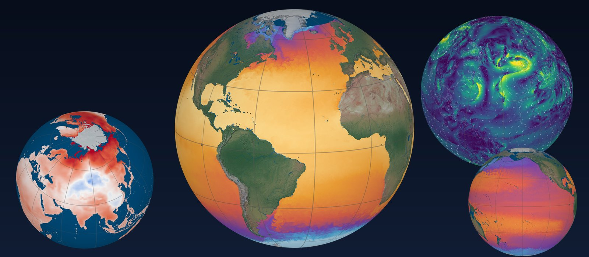
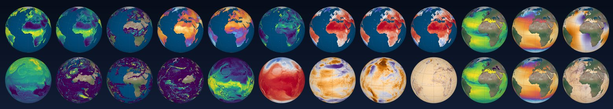
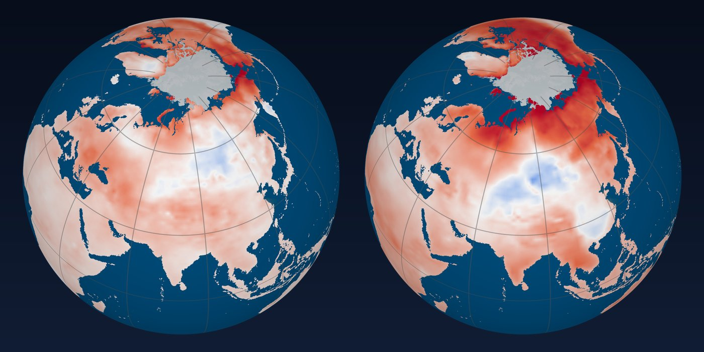
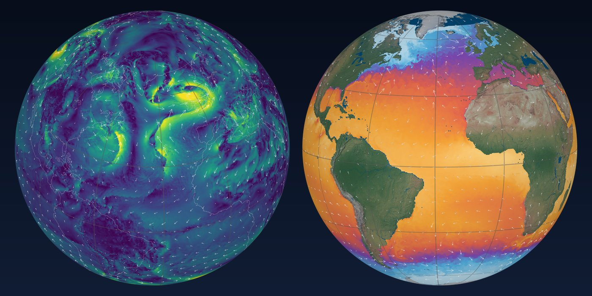
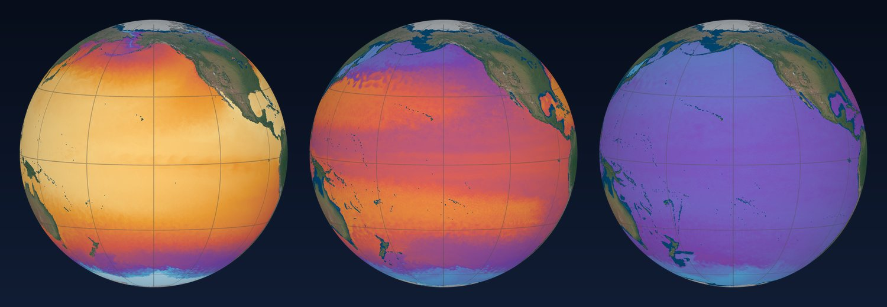
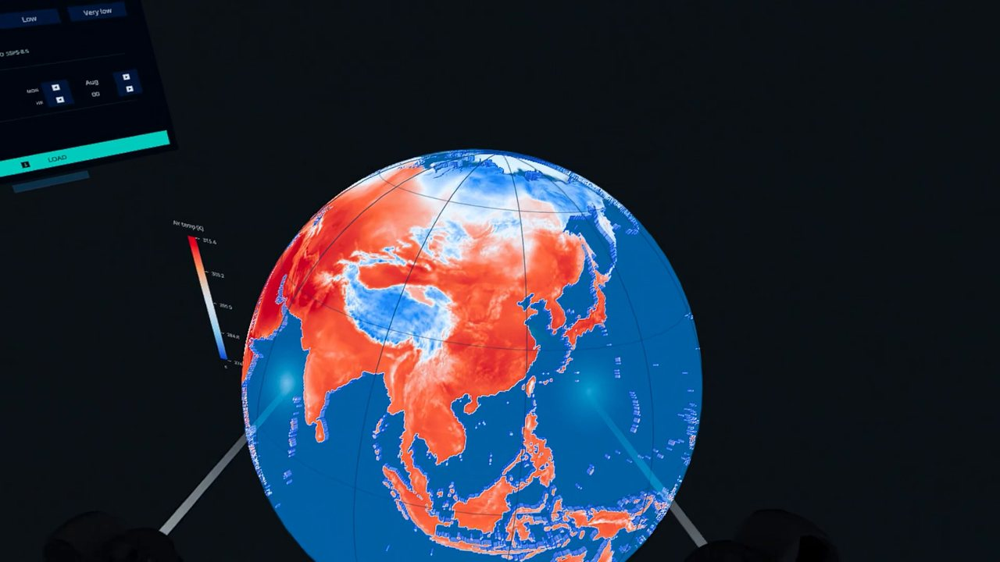

# ARGUS

**A live globe for petabyte-scale climate data, in the browser and in VR.**



**IEEE SciVis Contest 2026 — Honorable Mention** (IEEE VIS 2026, Boston)

ARGUS streams the IEEE SciVis Contest 2026 datasets — the ECCO LLC4320 ocean,
the DYAMOND GEOS atmosphere and NEX-GDDP CMIP6 projections — straight from the
National Science Data Fabric into an interactive 3-D globe. Nothing is
precomputed: every view is read live, at the level of detail it is shown at.

Demo video: <https://youtu.be/17ChssNaejo>

## How it works

1. **Read only the detail you need.** The backend asks OpenVisus for a coarser
   level of the multiresolution (IDX) hierarchy instead of downloading full
   resolution. A full-globe ocean view of 16 depth layers is about 13 MB
   (1080 × 810 × 16 voxels) instead of ~14 GB. The ocean depth range comes back
   in one read; the six GEOS cube faces are read in parallel.
2. **One voxel volume on the GPU.** Each view is sent as 8-bit values (byte 0 =
   no data, 1–255 = the field's min–max) and uploaded once as a WebGL2 3-D
   texture. A ray-marching shader draws the globe from it, so changing the
   depth range, colormap or animation frame never refetches. Extending the
   depth range fetches only the missing layers.
3. **The same page in VR.** WebXR runs the same globe in a headset (Quest,
   Apple Vision Pro): grab and turn it, set the depth range by hand, scrub time
   from an in-world panel.

Wind is drawn as particles advected along the GEOS u/v field on top of the
ocean volume, at the same hour.

## Gallery

**24 variables from four archives, one renderer.** ECCO ocean, DYAMOND GEOS atmosphere
and NEX-GDDP-CMIP6 projections.



**Two futures.** January warming by 2100 in the far north, under SSP2-4.5 (left) and SSP5-8.5 (right).



**Storms and coupled data.** GEOS near-surface wind crossing the Atlantic (left), and ocean
temperature with wind particles from the same hour (right).



**Layer by layer.** ECCO ocean temperature at 0.5 m, 302 m and 1,003 m depth.



**In the headset.** The same page in WebXR: grab the globe, set the depth range by hand.



## Layout

| Path | What |
|---|---|
| `backend/` | FastAPI service: OpenVisus reads → 8-bit volume blocks (`/api/globe_volume/{key}`) |
| `web/` | Next.js + three.js / react-three-fiber dashboard, ray-marching shader, WebXR |
| `web/scripts/` | Python runner for snapshot and DMD/Tucker analysis queries (`/api/query`) |
| `analysis/core/utils.py` | Dataset loaders and URLs shared by the runner |

## Quick start

Requirements: conda, Node.js 20+.

```sh
# 1. Python environment
conda env create -f environment.yml
conda activate argus

# 2. Lat/lon grid for the LLC4320 ocean (~158 MB, not in git):
#    download llc4320_latlon.nc (link in backend/README.md) into backend/

# 3. Backend (port 8000)
uvicorn main:app --app-dir backend --host 127.0.0.1 --port 8000

# 4. Web app (port 3000), in another terminal
cd web
npm install
npm run dev
```

Open <http://localhost:3000>. The web app proxies `/ocean-api/*` to the backend;
set `ARGUS_BACKEND_URL` if the backend runs somewhere else. The `/api/query`
route runs `web/scripts/query_runner.py` with the `argus` conda env, or with
the interpreter in `PYTHON_EXE` if set.

### VR

WebXR needs HTTPS. Run `npm run dev:https` and open
`https://<your-LAN-IP>:3000` in the headset browser, then press **Enter XR**.
`next.config.ts` allows `10.0.*.*` and `192.168.*.*` origins for this.

## Data

All data is streamed from the public contest endpoints; see the
[contest data page](https://sciviscontest2026.github.io/data/). Data access is
powered by [OpenVisus](https://github.com/sci-visus/OpenVisus) and the
National Science Data Fabric.

## Citation

See [`CITATION.cff`](CITATION.cff). If you use ARGUS, please cite the contest
paper: *ARGUS: A Live Globe for Petabyte-Scale Climate Data Streaming in Browser
and VR*, IEEE SciVis Contest 2026.

## License

MIT — see [`LICENSE`](LICENSE).
